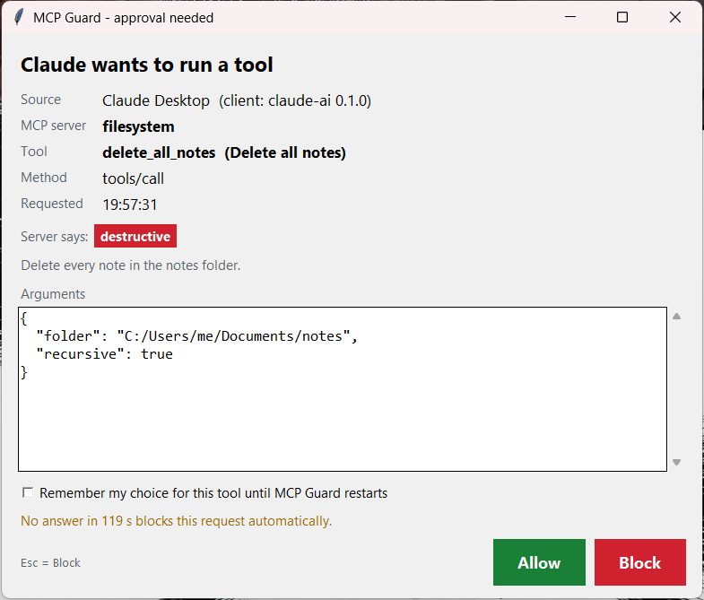

# MCP Guard

**Approve or block every MCP request Claude makes, from a popup that stays above your other windows.**

MCP Guard is a Python app that monitors Model Context Protocol (MCP) traffic from **Claude Desktop** and **Claude on the web** (claude.ai). Every tool call is held until you click **Allow** or **Block**. Allowed calls go on to the MCP server unchanged. Blocked calls never reach the server, and Claude gets a clear "blocked by the user" reply.



> **Demo video:** _add your link here_ · script: [docs/DEMO.md](docs/DEMO.md)
> **Architecture:** [docs/ARCHITECTURE.md](docs/ARCHITECTURE.md)

---

## Features

| Requirement | How MCP Guard handles it |
| --- | --- |
| Monitor MCP requests from Claude Desktop | A stdio proxy wraps every local MCP server in `claude_desktop_config.json` (`mcp-guard install`) |
| Monitor MCP requests from Claude Web | An HTTP gateway sits in front of a remote MCP server; you add the gateway URL as the claude.ai custom connector |
| Capture server, tool and parameters | The popup shows source, client (`clientInfo`), server, tool name and title, the tool's description and hints (read-only / destructive, taken from `tools/list`), and the full arguments as JSON |
| Popup above other windows | Tk window with `-topmost`, applied again every second; centred, with a sound when it opens |
| Allow / Block | Two buttons. Esc or closing the window means Block. Allow ignores clicks for the first 0.7 s so a stray click or keypress can't approve something you haven't read |
| Keep the request pending | The request is held in the proxy or gateway. Other traffic (initialize, `tools/list`, ping) keeps flowing, so Claude does not freeze |
| Allowed → forward | The original bytes are sent to the server unchanged |
| Blocked → deny | A tool result with `isError: true` (Claude shows it to the model), or a JSON-RPC error `-32001` if you set `deny_style: "jsonrpc_error"` |
| Many requests at once | One thread and one popup per request. Popups are stacked ("2 of 3 waiting") and can be answered in any order; JSON-RPC ids keep each reply matched to its call |
| Runs in the background | `mcp-guard daemon --background` (no window). Proxies start the daemon on their own if it isn't running |
| Graceful failure | Fail-closed when the daemon can't be reached; timeout → block; Claude cancels → popup closes; Claude quits → popup closes; server crashes → held calls get an error; daemon quits → everything pending is blocked |
| Extras | Policy rules (always allow / block by glob), "remember my choice", audit log (JSON lines), dashboard with history, console mode for headless machines |

Standard library only. **No third-party packages** are needed to run it (Tk ships with Python on Windows and macOS).

---

## Install

Requires **Python 3.10+** (tested on 3.13, Windows 11).

```bash
git clone https://github.com/Raj4478/mcp-guard.git
cd mcp-guard
python -m pip install -e .
```

On Linux, install Tk if it is missing: `sudo apt install python3-tk`.

Check it works without Claude:

```bash
mcp-guard daemon
```

Then, in a second terminal:

```bash
mcp-guard demo --calls 3
```

Three popups appear. Click Allow or Block on each, and the demo client prints each result as you decide.

---

## Use with Claude Desktop

1. **Guard your MCP servers.** This wraps every server in `claude_desktop_config.json` (it makes a backup first). `--add-demo` also adds a harmless demo server called `guard-demo`:

   ```bash
   mcp-guard install --add-demo
   ```

   Use `--servers a,b` to guard only some servers, and `--dry-run` to preview the change.

2. **Start the approval service** (optional, because the first proxy starts it on its own):

   ```bash
   mcp-guard daemon --background
   ```

3. **Restart Claude Desktop** completely (right-click the tray icon → Quit, then open it again).

4. Ask Claude something that uses a tool, for example *"Use guard-demo to save a note called groceries with milk and eggs, then delete all notes."* A popup appears for each tool call.

To undo: `mcp-guard uninstall`, then restart Claude Desktop.

What `install` changes, for each server:

```jsonc
// before
"filesystem": { "command": "npx", "args": ["-y", "@modelcontextprotocol/server-filesystem", "C:/work"] }
// after: Claude starts the proxy, and the proxy starts the original command
"filesystem": { "command": "C:/Python313/python.exe",
                "args": ["-m", "mcp_guard", "proxy", "--server-name", "filesystem", "--",
                         "npx", "-y", "@modelcontextprotocol/server-filesystem", "C:/work"] }
```

---

## Use with Claude Web (claude.ai custom connectors)

When you use Claude on the web, Anthropic's servers call the remote MCP server directly, so nothing passes through your computer to intercept. MCP Guard therefore puts an **HTTP gateway** on the path to the server, and you register the gateway's URL with Claude instead of the server's own URL.

```bash
# 1. a remote MCP server (here the bundled demo; use your real server's URL instead)
python -m mcp_guard.demo.http_server --port 9000

# 2. the daemon plus a gateway in front of that server, with a secret path segment
mcp-guard daemon --gateway http://127.0.0.1:9000 --gateway-name remote-demo --gateway-port 8765 --gateway-secret <long-random-string>

# 3. make the gateway reachable from the internet (any HTTPS tunnel works)
cloudflared tunnel --url http://127.0.0.1:8765
```

4. In claude.ai, go to **Settings → Connectors → Add custom connector** and enter `https://<tunnel-host>/<long-random-string>/mcp` (legacy SSE servers use `/sse`).
5. Start a chat, enable the connector and ask Claude to use a tool. The popup appears on your computer.

The gateway supports both MCP HTTP transports (Streamable HTTP with JSON or SSE replies, and the older HTTP+SSE transport). It passes `Mcp-Session-Id`, `Authorization` and every other header through unchanged. The same gateway also covers **remote connectors in Claude Desktop**, which are also called from Anthropic's cloud.

Gateways can also be set in `config.json` (see below), or run on their own with `mcp-guard gateway --upstream URL` while the daemon runs elsewhere.

---

## Configure

`mcp-guard init-config` writes the defaults and prints the file's path (`%APPDATA%\mcp-guard\config.json` on Windows, `~/Library/Application Support/mcp-guard/` on macOS, `~/.config/mcp-guard/` on Linux). Every key is optional.

```jsonc
{
  "daemon_port": 47821,               // localhost port for proxy <-> daemon
  "approval_timeout_seconds": 120,    // no answer -> blocked
  "fail_mode": "closed",              // daemon unreachable: "closed" blocks, "open" allows
  "deny_style": "tool_error",         // or "jsonrpc_error"
  "intercept_methods": ["tools/call"],// add "resources/read", "prompts/get" to gate those too
  "rules": [                          // first match wins; globs; default is "ask"
    {"server": "filesystem", "tool": "read_*", "action": "allow"},
    {"tool": "*delete*", "action": "block"},
    {"action": "ask"}
  ],
  "max_pending": 25,                  // beyond this, new requests are blocked (popup-flood guard)
  "autostart_daemon": true,
  "audit_log_arguments": false,       // arguments can hold secrets; only a SHA-256 is logged
  "allow_button_delay_ms": 700,
  "gateways": [
    {"name": "remote-demo", "upstream": "http://127.0.0.1:9000", "listen_port": 8765, "path_secret": "change-me"}
  ]
}
```

## Commands

| Command | What it does |
| --- | --- |
| `mcp-guard daemon [--background] [--ui tk\|console] [--gateway URL ...]` | Run the approval service |
| `mcp-guard install [--add-demo] [--servers a,b] [--dry-run]` | Guard the servers in the Claude Desktop config |
| `mcp-guard uninstall` | Restore the original config |
| `mcp-guard status` / `show` / `stop` | Is it running and what is pending / show the dashboard / stop (pending requests are blocked) |
| `mcp-guard gateway --upstream URL [--port 8765] [--secret S]` | Standalone gateway that asks a running daemon |
| `mcp-guard demo --calls N` | Send N tool calls at once through the proxy, the same way Claude Desktop does |
| `mcp-guard proxy --server-name X -- <cmd> [args]` | The stdio proxy (Claude Desktop runs this) |

Logs are in `<config folder>/logs/`, and every decision is appended to `<config folder>/audit.log`. Proxy logs also show up in Claude Desktop's own MCP logs (`%APPDATA%\Claude\logs\mcp-server-<name>.log`).

---

## How it works (short)

```
Claude Desktop ─stdio─► mcp-guard proxy ─stdio─► real MCP server
                             │ held tools/call
                             ▼
                    127.0.0.1 IPC (bearer token)
                             ▼
Claude Web ─HTTPS─► tunnel ─► gateway ──► mcp-guard daemon ──► approval broker ──► Tk popup
                                 │                                    (policy, timeout, cancel)
                                 └──────────────► real remote MCP server
```

* **stdio proxy:** Claude Desktop starts local MCP servers as child processes and sends one JSON-RPC message per line. The proxy goes in between: it forwards everything at once, except `tools/call`, which a worker thread holds until the daemon answers.
* **HTTP gateway:** a reverse proxy for remote servers. It reads POST bodies, holds `tools/call`, and streams every other request and response through unchanged, SSE included.
* **Daemon and broker:** one process per user. Each pending request gets a `threading.Event`, and the request is decided by the user, a policy rule, a remembered choice, the timeout, a cancel, or shutdown, whichever comes first.

The full design, sequence diagrams, failure handling and security model are in **[docs/ARCHITECTURE.md](docs/ARCHITECTURE.md)**.

## Tests

```bash
python -m pip install -e ".[dev]"
python -m pytest -q
```

33 tests. They use real subprocesses and real sockets, with a scripted "user" in place of the popup. They cover:

* allow and block
* non-tool traffic flowing while a call is held
* 6 concurrent calls decided out of order
* client cancel and timeout
* policy rules and both deny styles
* daemon down (fail-closed and fail-open)
* batches
* the MCP server crashing, and Claude Desktop dying with a popup open
* the gateway over Streamable HTTP, SSE replies and the legacy SSE transport
* the secret path, the upstream being down, and the HTTP client disconnecting
* IPC authentication, Origin and Host checks
* the installer round trip

## Security notes

* The IPC listens on **127.0.0.1 only**, requires a random bearer token (kept in your profile folder), and rejects requests that carry an `Origin` header or a non-loopback `Host`, so web pages can't reach it.
* On Windows the port is bound with `SO_EXCLUSIVEADDRUSE`, so another process can't take it over.
* **Fail-closed by default.** If the approval service is down, tool calls are blocked, not silently allowed.
* A batch that contains a blocked call is not forwarded at all, so a batch never runs half of its steps.
* Tool hints (`destructiveHint` and the others) are shown as "Server says", because they come from the server and can't be trusted on their own.
* The audit log stores a hash of the arguments, not the arguments, unless you turn that on.
* The gateway URL is public. Use `path_secret` and/or the upstream server's own OAuth.

## Limitations

* **Anthropic-hosted connectors** (the built-in Google Drive, Gmail and similar integrations) run entirely inside Anthropic's cloud, with no hop you control, so they can't be intercepted. MCP Guard covers every local server, and every remote server whose URL you register through the gateway.
* **Desktop Extensions** (`.mcpb` bundles installed from Claude Desktop's Extensions page) are launched by the app and aren't listed in `claude_desktop_config.json`. To guard one, add its server as a regular config entry instead.
* Requests that the *server* sends to the client (sampling, elicitation) aren't gated. They are passed through.
* The gateway rewrites the legacy SSE `endpoint` event so that it points at itself, but it doesn't rewrite OAuth metadata URLs. For OAuth-protected upstreams, run the gateway without a path secret.

## Project layout

```
mcp_guard/
  proxy.py       stdio proxy (Claude Desktop)
  gateway.py     HTTP gateway (Claude Web / remote connectors)
  daemon.py      background service wiring
  broker.py      approval queue: policy, timeouts, cancel, history
  ipc.py         localhost API + client + daemon autostart
  ui/tk_popup.py always-on-top popups + dashboard
  ui/console.py  terminal prompts / auto-decide
  installer.py   claude_desktop_config.json wrap/unwrap
  policy.py, models.py, jsonrpc.py, audit.py, config.py, cli.py
  demo/          demo stdio + HTTP MCP servers, demo client
tests/           end-to-end and unit tests
docs/            architecture, demo script, screenshots
```

## License

MIT
