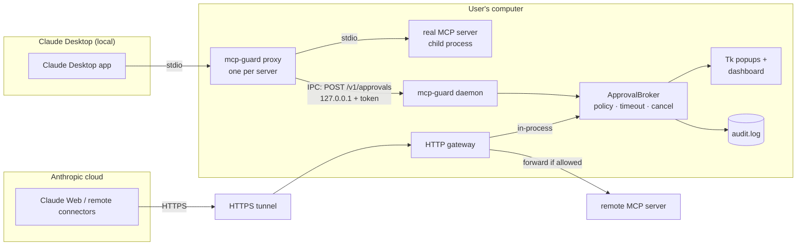
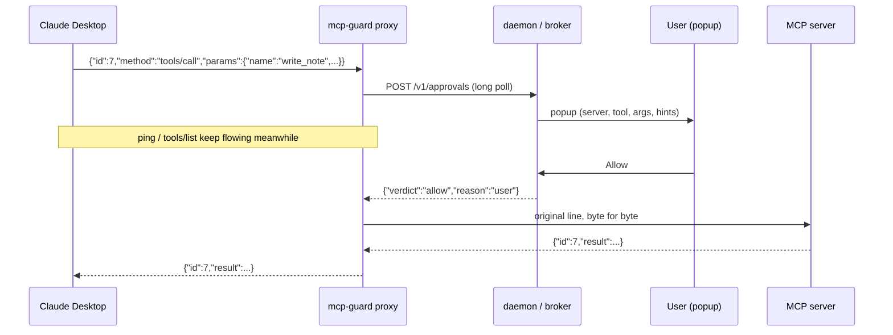

# Architecture

## 1. The problem: where can an MCP call be stopped?

MCP is JSON-RPC 2.0 over a transport. The two Claude clients reach servers in different ways, and the interception point has to sit on the path each one actually uses.

| Client | How it reaches MCP servers | Where a call can be held |
| --- | --- | --- |
| Claude Desktop, local servers | The app starts each server in `claude_desktop_config.json` as a **child process** and talks over **stdin/stdout**, one JSON message per line | Between the app and the child process: a **stdio proxy** |
| Claude Web (claude.ai) custom connectors | **Anthropic's servers** call the server's URL over HTTPS (Streamable HTTP or HTTP+SSE). The browser only shows the result | On the network path to the server: an **HTTP gateway** whose URL is registered as the connector |
| Claude Desktop remote connectors | Same as Claude Web (cloud to server) | Same gateway |

### Approaches considered and rejected

* **Sniffing network traffic / TLS interception (mitmproxy) on the user's machine.** Local stdio servers don't use the network at all. For Claude Web, the tool call is made from Anthropic's datacenter, so by the time the browser sees a `tool_use` event the call has already run. Blocking is impossible from there.
* **A browser extension.** Same problem: the browser only observes. It could hide a result, but it can't stop the call from running.
* **Patching or hooking the Claude Desktop app.** Fragile across updates, depends on the platform, and invasive.
* **Relying on the per-tool permission prompt inside Claude.** That prompt is part of the client being supervised. MCP Guard is an independent gate at the protocol level that the client can't bypass, and it adds policy rules, an audit log and fail-closed behaviour.

**The approach used:** wrap the transport. Every MCP message from Claude has to pass through a component MCP Guard owns (the proxy or the gateway). That component holds the request until a decision arrives, then forwards it or replies with a denial. This works the same way for every MCP server, and the servers need no changes.

## 2. Components



| Module | Responsibility |
| --- | --- |
| `proxy.py` | stdio proxy: relays both directions, holds `tools/call`, handles cancel, batches and child exit |
| `gateway.py` | HTTP reverse proxy: holds `tools/call` in POST bodies, relays JSON and SSE, supports the legacy SSE transport |
| `ipc.py` | Localhost HTTP API (server + client), daemon autostart, disconnect detection |
| `broker.py` | The approval queue. Thread-safe, one `Event` per request. Decides by policy, remembered choice, user, timeout, cancel, overload or shutdown |
| `ui/tk_popup.py` | Always-on-top popups and a history dashboard. Owns the main thread |
| `daemon.py` | Wires the broker, IPC, gateways, UI, signals and clean shutdown together |
| `installer.py` | Rewrites `claude_desktop_config.json` reversibly |
| `policy.py`, `audit.py`, `models.py`, `jsonrpc.py`, `config.py` | Rules, the audit trail, data types, protocol helpers, settings |

## 3. Request lifecycle

### Allow (Claude Desktop)



### Block

Same as above up to the click. Then the daemon answers `block`, the proxy **never writes to the server**, and it sends Claude:

```json
{"jsonrpc":"2.0","id":7,"result":{"isError":true,"content":[{"type":"text",
 "text":"MCP Guard blocked 'delete_all_notes' on server 'guard-demo': the user clicked Block. Do not retry unless the user asks you to."}]}}
```

A tool result with `isError: true` is the MCP way to report a failure the model should see, so Claude tells the user what happened. `deny_style: "jsonrpc_error"` sends error code `-32001` instead. Methods other than `tools/call` always get a JSON-RPC error.

### Concurrency

* The proxy's main thread only reads lines and routes them; it never waits on a decision. Each held request gets its **own worker thread** that does the blocking IPC call. Ten calls at once means ten threads and ten popups.
* Writes to Claude's stdout and to the server's stdin each go through their own lock, so lines from different threads never interleave.
* The broker keeps `request_id → (request, Event)`. The UI resolves any of them in any order. Replies reach Claude in **decision order**, and the JSON-RPC ids match them up (a test sends 6 calls and decides them in reverse order).
* The IPC server and the gateway are `ThreadingHTTPServer`s (a thread per connection), so a long-poll never blocks other requests.
* Tk is not thread-safe. Worker threads only put events on a `queue.Queue`, and the Tk main loop reads it every 100 ms.
* `max_pending` (25 by default) caps how many popups can be open. Past that, new requests are blocked at once, so a misbehaving client can't flood the screen.

### Batches

JSON-RPC batches (allowed by the 2025-03-26 spec) are handled as a unit. Every gated request in the batch gets a popup at the same time. If all are allowed, the original batch is forwarded. If any is blocked, **nothing is forwarded**: blocked requests get denials and the others get `-32002 "Not run: another request in the same batch was blocked"`. This way a batch never runs half of its steps.

## 4. Failure handling

| Situation | Behaviour |
| --- | --- |
| Nobody answers | Blocked after `approval_timeout_seconds` (120 s by default); the popup shows a countdown |
| User closes the popup or presses Esc | Blocked (`dismissed` / `user`) |
| Claude cancels (`notifications/cancelled`) | Popup closed. The request and its cancel are both dropped, because the server never saw the request, and the spec says a cancelled request gets no reply |
| Claude Desktop quits or restarts the server | The proxy's stdin closes, so it cancels held requests and stops the server politely (stdin close → terminate → kill). If the proxy itself is killed, the daemon sees the IPC socket close (`MSG_PEEK` check) and closes the popup |
| Claude Web gives up on an HTTP request | The gateway sees the client socket close and cancels the approval, so a late Allow can't run a call nobody is waiting for |
| MCP server crashes | Held calls get error `-32003`, and the proxy exits with the server's exit code so Claude shows the server as disconnected |
| Server command not found | The proxy logs it to stderr (visible in Claude's MCP log) and exits with code 127 |
| Daemon not running | The proxy starts it (`pythonw`, detached, breaking away from Claude's job object). If that fails, the request is blocked (`fail_mode: "closed"`, the default) or allowed (`"open"`) |
| Daemon stops (Quit, `mcp-guard stop`, Ctrl+C, SIGTERM) | Everything pending is blocked with reason `shutdown`, and new requests are refused |
| Second daemon started | The port is taken (exclusive bind), so it prints "already running" and exits |
| UI error | The request is blocked, never left hanging |
| Upstream (remote) server down | The gateway returns `502` |
| Malformed JSON from the client | Forwarded unchanged, so the server returns its own parse error. The proxy never invents protocol behaviour |
| Bad config values | Logged and replaced with defaults. Startup never fails because of a typo |

## 5. macOS: popups over full-screen apps

On macOS every full-screen app has its own **Space** (virtual desktop). A new window from another app opens on that app's own Space, normally the plain desktop, and never over someone else's full-screen Space. `-topmost` doesn't help, because it only orders windows within one Space. With Claude running full screen, the popup was created correctly but on a Space the user wasn't looking at, so the request timed out and was blocked.

How it was diagnosed: Tk reported the popup as mapped, visible and topmost. The macOS window server (`CGWindowListCopyWindowInfo`) showed it at the right position on the floating layer (19), but `onscreen=false`, so it was on the wrong Space. A crash, a bad position, or the window sitting behind Claude were all ruled out.

The fix, in `mcp_guard/ui/macos.py`:

1. The daemon becomes an **accessory app** (`setActivationPolicy:` = Accessory, so no Dock icon). macOS only lets accessory apps put windows over a full-screen Space.
2. Each popup's NSWindow gets `canJoinAllSpaces | fullScreenAuxiliary`, added to the flags Tk already set. It is then hidden and re-shown with `orderFrontRegardless`, because new flags don't move a window that is already on a Space.
3. The app is **never activated**, so the user stays in Claude's Space. Activating it was tried, and it switched the user to the desktop, which is worse than the bug.

Tk has no API for these settings, and the project avoids PyObjC, so the module calls the Objective-C runtime through `ctypes` (`objc_msgSend`). On Apple Silicon, `objc_msgSend` must be called through a prototype that matches each method exactly, so every call builds its own `CFUNCTYPE`. Tk doesn't expose its NSWindow either, so popups are found by title: one shared `POPUP_TITLE` constant is used for both the Tk title and the matcher, so the two can't drift apart. Everything is best-effort: on other platforms, or on any error, nothing happens, and the worst case is the old fail-closed behaviour. `tests/test_macos.py` opens a real popup on the macOS CI runner and reads the flags back from the NSWindow.

## 6. Security model

* **Trust boundary.** Anything that can run code as the user can already do anything the user can do, so the goal is to stop *other* parties (web pages, other users, remote callers) from forging or skipping approvals.
* **IPC.** Bound to `127.0.0.1`. It needs a 256-bit bearer token, compared in constant time, stored in the user's profile folder and created with `O_EXCL` (0600 on POSIX). Requests with an `Origin` header or a non-loopback `Host` are refused, which blocks CSRF and DNS-rebinding attacks from browsers. Bodies are capped at 1 MB, and fields from IPC are clipped before display.
* **Port takeover.** `SO_EXCLUSIVEADDRUSE` on Windows (and no `SO_REUSEADDR`), so a squatter can't bind the daemon's port alongside it.
* **Fail-closed** by default. An unknown error is always a block.
* **No accidental approval.** There is no keyboard shortcut for Allow. Allow is ignored for the first 700 ms after a popup opens, and the window can't be dismissed into an allow.
* **Untrusted hints.** Tool annotations come from the server. They are labelled "Server says" and never used to auto-allow anything.
* **Privacy.** The audit log keeps a SHA-256 of the arguments, not the arguments, unless `audit_log_arguments` is on.
* **Gateway exposure.** The tunnel URL is public, so `path_secret` adds an unguessable first path segment. The upstream's own auth headers are passed through unchanged.

## 7. Why these choices

* **Standard library only.** `http.server`, `http.client`, `subprocess`, `threading` and `tkinter` cover everything, so there is nothing extra to install and the attack surface is smaller.
* **Threads, not asyncio.** On Windows, reading a console or pipe stdin asynchronously is unreliable. Blocking reads on dedicated threads are simple and portable. The amount of concurrency involved (a handful of pending calls) fits threads well.
* **One daemon, many proxies.** Claude Desktop starts one process per server, so per-server proxies are required. One daemon then gives a single place for popups, policy, "remember" and the audit log, and keeps the UI on one main thread.
* **The proxy forwards original bytes.** Allowed messages are passed through byte for byte, never re-serialized, so the proxy can't change what the server receives.
